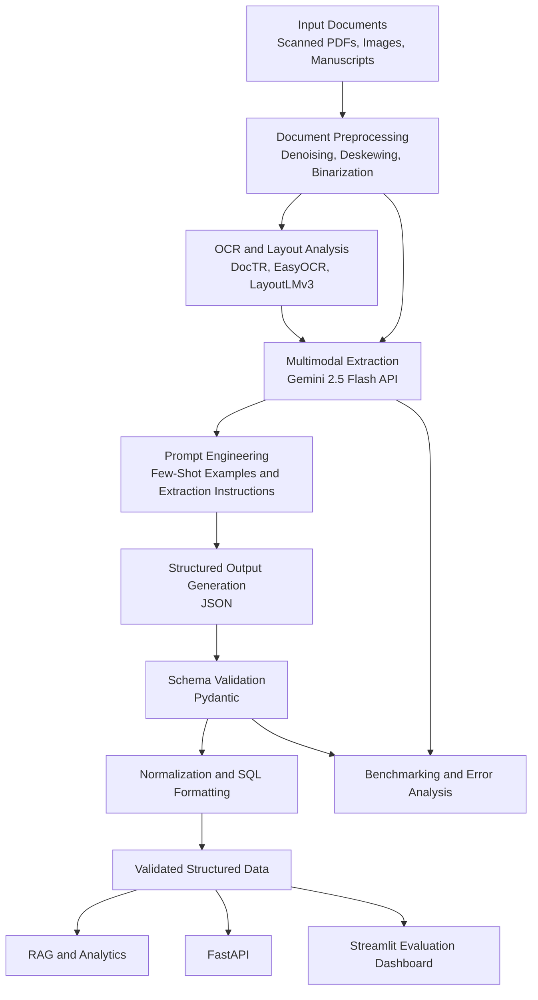

# DocFlow — Multimodal LLM Knowledge Extraction & Prompt Evaluation Pipeline

<p align="center">
  <strong>Transforming degraded documents into structured, validated, and analysis-ready data using OCR, multimodal LLMs, and systematic evaluation.</strong>
</p>

<p align="center">
  
  
  
  
  
  
  
</p>

---

## Overview

**DocFlow** is a multimodal document-intelligence framework designed to extract reliable, structured information from noisy, low-resolution, and degraded documents, including historical manuscripts, technical reports, scanned PDFs, and invoices.

The pipeline combines traditional optical character recognition (OCR), document-layout analysis, multimodal large language models (LLMs), structured prompt engineering, and schema validation to transform unstructured documents into machine-readable outputs suitable for downstream analytics and retrieval-augmented generation (RAG).

Unlike conventional OCR pipelines that primarily focus on character recognition, DocFlow combines visual context with textual information to resolve ambiguous text, interpret complex layouts, and reduce extraction errors.

### Key Features

* **Multimodal Document Ingestion:** Combines OCR engines and document-layout analysis with the Gemini 2.5 Flash API.
* **Intelligent Preprocessing:** Supports image denoising, deskewing, and binarization to improve document readability.
* **Structured Prompt Engineering:** Uses few-shot examples and carefully designed extraction instructions to improve output consistency.
* **Schema-Validated Extraction:** Uses Pydantic to validate extracted fields and produce structured JSON.
* **Forensic Error Analysis:** Categorizes extraction failures into hallucinations, omissions, and layout-boundary errors.
* **Benchmarking Framework:** Compares six document-AI architectures using a common evaluation suite.
* **Visual Evaluation Dashboard:** Provides side-by-side OCR and LLM comparisons, bounding-box visualizations, and error analysis.
* **API Integration:** Exposes document-ingestion functionality through FastAPI.
* **Automated Testing:** Includes unit, integration, and benchmark tests using Pytest.

---

## Architecture



### Pipeline Stages

| Stage | Component               | Responsibility                                                            |
| ----- | ----------------------- | ------------------------------------------------------------------------- |
| 1     | Document preprocessing  | Improve image quality and readability.                                    |
| 2     | OCR and layout analysis | Extract text, bounding boxes, and spatial relationships.                  |
| 3     | Multimodal extraction   | Combine visual context and OCR output using Gemini.                       |
| 4     | Prompt engineering      | Guide the model toward consistent, task-specific extraction.              |
| 5     | Schema validation       | Validate field types, required fields, and output structure.              |
| 6     | Normalization           | Convert extracted information into structured JSON and SQL-ready records. |
| 7     | Evaluation              | Measure extraction quality and classify errors.                           |

---

## Technology Stack

| Category               | Technologies                |
| ---------------------- | --------------------------- |
| Programming Language   | Python 3.11+                |
| Multimodal AI          | Google Gemini 2.5 Flash API |
| OCR                    | DocTR, EasyOCR              |
| Document Understanding | LayoutLMv3                  |
| Data Validation        | Pydantic                    |
| Data Processing        | Pandas, NumPy               |
| Database Integration   | SQL                         |
| API Development        | FastAPI                     |
| Interactive Dashboard  | Streamlit                   |
| Testing                | Pytest                      |
| Containerization       | Docker                      |

---

## Repository Structure

```text
DocFlow/
│
├── pipeline/
│   ├── __init__.py
│   ├── config.py
│   ├── preprocessor.py
│   ├── layout_analyzer.py
│   ├── gemini_extractor.py
│   └── validator.py
│
├── evaluation/
│   ├── __init__.py
│   └── benchmark_runner.py
│
├── server/
│   ├── __init__.py
│   └── api.py
│
├── dashboard/
│   ├── app.py
│   └── components.py
│
├── tests/
│   ├── test_ocr.py
│   ├── test_gemini.py
│   ├── test_pipeline.py
│   └── test_benchmarks.py
│
├── data/
│   ├── sample_docs/
│   ├── ground_truth.json
│   └── benchmark_results.json
│
├── main.py
├── Dockerfile
├── requirements.txt
├── pytest.ini
├── .gitignore
├── INSTRUCTIONS.md
└── README.md
```

---

## Benchmark Results

The following metrics represent the reported results from the DocFlow evaluation suite. Reproduce them using the benchmark configuration and ground-truth annotations before treating them as independently verified results.

### Extraction Performance

| Metric                         | Reported Result |
| ------------------------------ | --------------: |
| Recall                         |          97.37% |
| F1-Score                       |          95.59% |
| Initial Precision              |           81.6% |
| Final Precision                |           90.2% |
| Initial False-Positive Errors  |             177 |
| Final False-Positive Errors    |             118 |
| False-Positive Error Reduction |          33.33% |
| Architectures Evaluated        |               6 |

### Key Improvements

* **Higher precision:** Improved reported precision from 81.6% to 90.2%.
* **Fewer false positives:** Reduced reported false-positive extraction errors from 177 to 118.
* **High recall:** Achieved a reported recall of 97.37%.
* **Systematic evaluation:** Compared six document-AI architectures using structured test cases and categorized error analysis.

> **Evaluation note:** Recall, precision, and F1-score depend on the evaluation unit, matching rules, and ground-truth annotations. Document the test-set size, baseline configuration, and averaging method alongside benchmark results for reproducibility.

---

## Core Technical Concepts

### 1. OCR and Layout Understanding

Traditional OCR systems identify text and its position in an image, but degraded documents and complex layouts can introduce recognition and segmentation errors.

DocFlow combines OCR output with layout information to preserve spatial context and improve downstream extraction.

**Components:**

* DocTR and EasyOCR for text recognition.
* LayoutLMv3 for document-layout understanding.
* Image preprocessing for denoising, deskewing, and binarization.

### 2. Multimodal LLM Extraction

The Gemini 2.5 Flash API processes document images and relevant OCR text to help resolve ambiguous characters, interpret tables, and extract information according to a defined schema.

The extraction workflow uses task-specific instructions and examples to improve consistency.

**Important:** Multimodal reasoning does not guarantee factual correctness. Extracted fields should be validated against source evidence whenever possible.

### 3. Structured Prompt Engineering

The extraction pipeline can use:

* **Few-shot prompting:** Provides examples of expected inputs and outputs.
* **Explicit extraction instructions:** Defines what information to extract and how to handle missing values.
* **Structured output constraints:** Encourages consistent JSON generation.
* **Pydantic validation:** Checks field types, required values, and schema compliance.
* **Post-processing rules:** Validates formats such as dates, identifiers, and monetary amounts.

Schema validation ensures structural correctness, not necessarily factual correctness.

### 4. Forensic Error Analysis

DocFlow evaluates more than aggregate performance metrics. It categorizes common extraction failures to identify opportunities for improvement.

| Error Category       | Description                                                  | Potential Mitigation                            |
| -------------------- | ------------------------------------------------------------ | ----------------------------------------------- |
| Hallucinations       | Extracted information is unsupported by the source document. | Source-grounded extraction and evidence checks. |
| Omissions            | Relevant text, table cells, or annotations are missed.       | OCR improvements and targeted re-extraction.    |
| Boundary Errors      | Text is incorrectly segmented across columns or regions.     | Layout analysis and bounding-box inspection.    |
| Formatting Errors    | Output does not match the required schema.                   | Structured generation and Pydantic validation.  |
| Normalization Errors | Correctly extracted values are represented inconsistently.   | Type conversion and domain-specific validation. |

### 5. Benchmarking Methodology

The evaluation framework compares six document-AI architectures using a common set of test cases.

A reproducible evaluation should:

1. Establish a fixed test set with ground-truth annotations.
2. Define the extraction unit and matching criteria.
3. Evaluate each architecture using the same inputs.
4. Calculate precision, recall, and F1-score.
5. Categorize errors by failure type.
6. Compare baseline and optimized configurations.
7. Save predictions, metrics, and benchmark configurations for analysis.

This approach makes it easier to identify whether performance improvements come from preprocessing, model selection, prompt changes, or post-processing.

---

## Installation and Setup

### Prerequisites

* Python 3.11 or later.
* Git.
* A Google Gemini API key.
* Internet access for API-based extraction.
* Docker, if using containerized deployment.

### 1. Clone the Repository

```bash
git clone https://github.com/Satvik-gupta1/DocFlow.git
cd DocFlow
```

### 2. Create a Virtual Environment

**Windows — PowerShell**

```powershell
python -m venv venv
.\venv\Scripts\Activate.ps1
```

**Windows — Command Prompt**

```cmd
python -m venv venv
venv\Scripts\activate.bat
```

**Linux / macOS**

```bash
python3 -m venv venv
source venv/bin/activate
```

### 3. Install Dependencies

```bash
python -m pip install --upgrade pip
pip install -r requirements.txt
```

### 4. Configure the Gemini API Key

Obtain an API key through the official [Google AI Studio](https://aistudio.google.com/) interface.

**Windows — PowerShell**

```powershell
$env:GEMINI_API_KEY="your-api-key"
```

**Windows — Command Prompt**

```cmd
set GEMINI_API_KEY=your-api-key
```

**Linux / macOS**

```bash
export GEMINI_API_KEY="your-api-key"
```

Replace `your-api-key` with your actual API key. Never commit API keys or other secrets to GitHub.

### 5. Run the Pipeline

```bash
python main.py
```

### 6. Launch the Dashboard

```bash
streamlit run dashboard/app.py
```

Open the local address displayed by Streamlit, typically:

```text
http://localhost:8501
```

### 7. Run the Test Suite

```bash
python -m pytest -v
```

Run a specific test module:

```bash
python -m pytest tests/test_pipeline.py -v
```

> **Setup note:** These commands assume the repository contains the modules and scripts shown above. Verify that `requirements.txt`, the API configuration, and the entry points match the actual implementation before running the project.

---

## Docker Deployment

Build the Docker image:

```bash
docker build -t docflow .
```

Run the pipeline while passing the API key through an environment variable:

```bash
docker run --rm \
  -e GEMINI_API_KEY="$GEMINI_API_KEY" \
  docflow
```

For production deployments, use an appropriate secrets-management mechanism and configure resource limits, logging, and API error handling.

The command above assumes the Docker image is configured to execute the pipeline. Dashboard and API deployment may require separate commands or service configurations.

---

## Example Output

A document extraction task can produce structured JSON similar to the following:

```json
{
  "document_type": "invoice",
  "invoice_number": "INV-1042",
  "invoice_date": "2026-08-12",
  "vendor": {
    "name": "Example Technologies",
    "address": "Jaipur, Rajasthan"
  },
  "total_amount": 12500.00,
  "currency": "INR",
  "validation_status": "passed"
}
```

This is an illustrative example of the target output format, not a guaranteed response from the current implementation.

The validated data can subsequently be transformed into relational records for reporting, analytics, or retrieval systems.

---

## Testing and Quality Assurance

DocFlow includes a test structure covering the major stages of the pipeline.

| Test Module          | Purpose                                              |
| -------------------- | ---------------------------------------------------- |
| `test_ocr.py`        | Tests OCR text extraction and bounding-box behavior. |
| `test_gemini.py`     | Tests extraction prompts and JSON schema compliance. |
| `test_pipeline.py`   | Tests end-to-end pipeline integration.               |
| `test_benchmarks.py` | Tests precision, recall, and F1-score calculations.  |

Recommended additional tests include:

* Missing or malformed API responses.
* Documents with empty or unreadable pages.
* Invalid JSON and schema violations.
* Missing required fields.
* Duplicate extraction and normalization errors.
* Rate limits, API timeouts, and retry behavior.
* Regression tests for previously identified extraction failures.

---

## Future Enhancements

* **Retrieval-Augmented Generation:** Index validated document content for semantic search and question answering.
* **Human-in-the-Loop Review:** Add confidence-based review queues for ambiguous or unsupported extractions.
* **Evidence Traceability:** Associate extracted fields with source text, page numbers, and bounding boxes.
* **Expanded Benchmarking:** Compare additional OCR engines, multimodal models, and preprocessing configurations.
* **Confidence Calibration:** Evaluate whether model confidence correlates with actual extraction correctness.
* **Production Monitoring:** Track latency, API costs, extraction failures, and performance drift.
* **Database Integration:** Persist normalized records in a relational database.
* **Document Security:** Add access controls, sensitive-data handling, and configurable retention policies.

---

## License

This project is distributed under the MIT License. See the [`LICENSE`](LICENSE) file for details.

---

## Author

**Satvik Gupta**

* GitHub: [@Satvik-gupta1](https://github.com/Satvik-gupta1)
* Project: [DocFlow](https://github.com/Satvik-gupta1/DocFlow)

---

<p align="center">
  <strong>DocFlow — From Unstructured Documents to Structured Intelligence.</strong>
</p>
